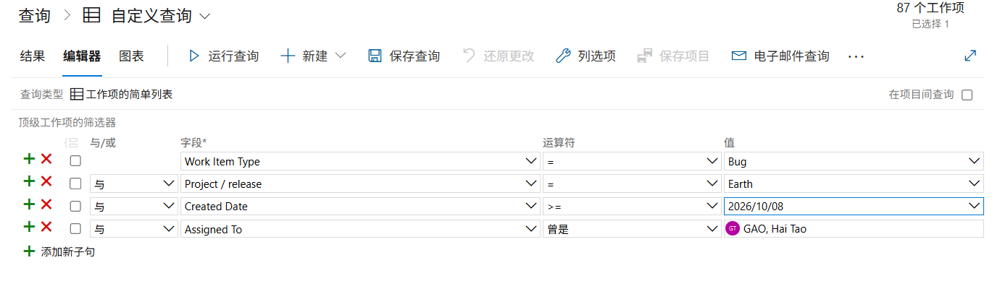

# Validation Method

1. Use below query condictions

1. Execute the query, and add Tags to the columns

1. Export the query result to CSV

1. Mannually run [Manul Run](./Manul-run.md)

1. Compare below items
   * Total item count
   * Select 2 issues and check the resoluiton with [Bug Classfication](../ai-agent-harness/agents/bug-status-agent.md)